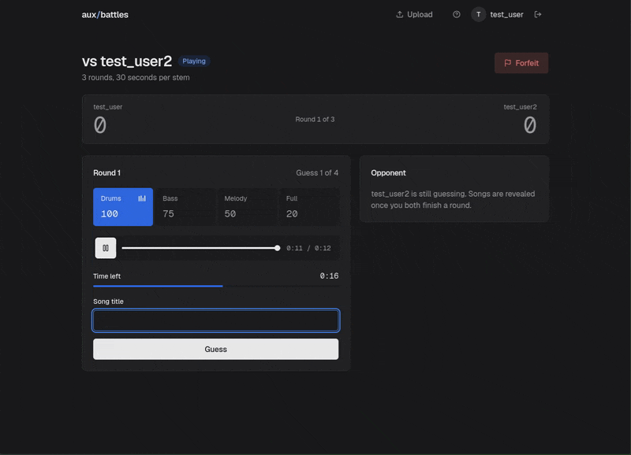
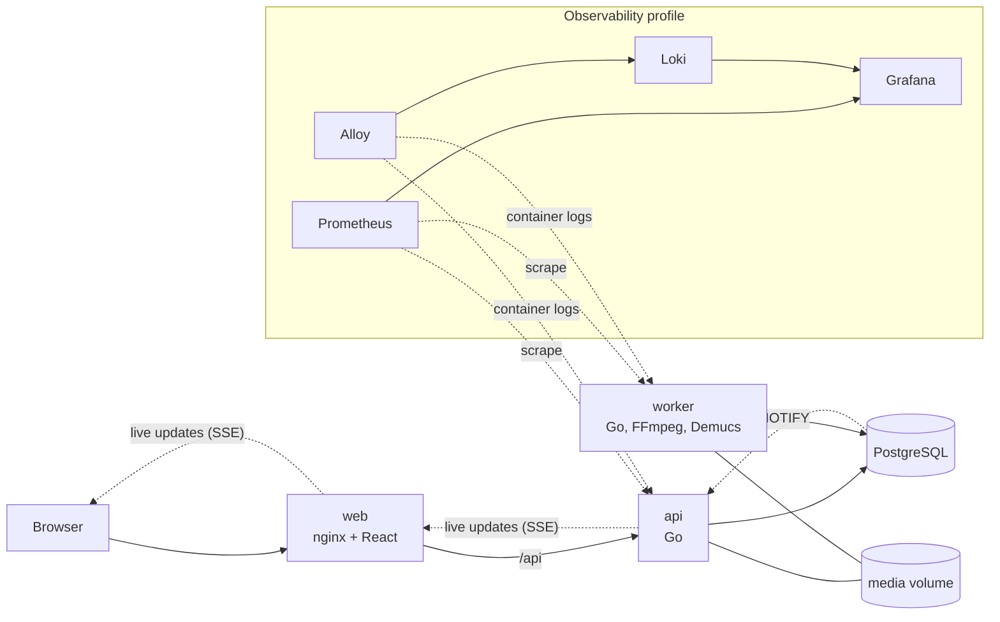
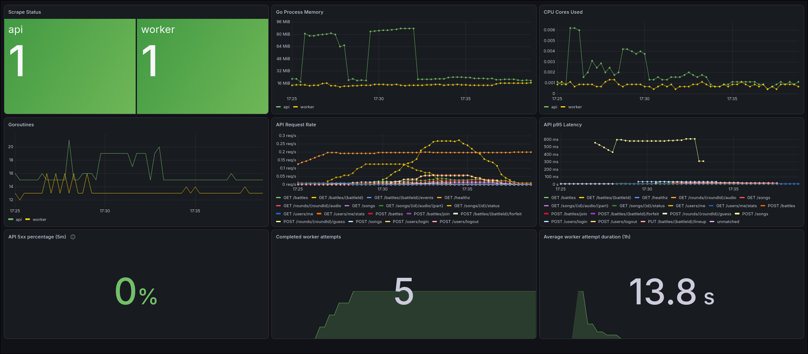

# aux-battles

[](https://github.com/kericchhh/aux-battles/actions/workflows/ci.yml)

A two-player song guessing game. Each round you hear your opponent's song one
stem at a time, drums first, then bass, melody and the full mix, and earlier
correct guesses score more. A Go API and worker, a React client and PostgreSQL
run together in Docker Compose, with a CI/CD pipeline and an observability
stack around them.



Full 40-second walkthrough


https://github.com/user-attachments/assets/b1b42644-cd32-45ce-9514-35b44c18191c


## What this project demonstrates

- **Containers:** multi-stage images for the API, worker and web client; the
  API and worker run as a non-root user; Compose starts services in order
  behind health checks and runs migrations as a one-shot job
  ([compose.yaml](compose.yaml)).
- **CI/CD:** every pull request runs Go and TypeScript checks, race-detector
  tests against migrated PostgreSQL databases, and image builds. Pushes to
  `main` publish images to GitHub Container Registry only after the Go, web
  and image jobs pass, and version tags also publish versioned images and a
  GitHub release ([ci.yml](.github/workflows/ci.yml)).
- **Supply-chain security:** `govulncheck` for Go code, Trivy scans of every
  image that fail the build on fixable high and critical vulnerabilities,
  actions pinned to commit SHAs, least-privilege tokens, and grouped
  Dependabot updates across five ecosystems
  ([dependabot.yml](.github/dependabot.yml)).
- **Observability:** Prometheus metrics from both services, JSON logs shipped to
  Loki by Alloy, and a provisioned Grafana dashboard and alerts
  ([observability guide](docs/observability.md)).
- **Operations:** runbooks for each worker alert, including failure and
  recovery drills ([runbooks](docs/runbooks)).

## Architecture



An admin uploads an MP3 to the API, which stores it on the shared media volume,
checks it with ffprobe and queues a job in PostgreSQL. The worker claims jobs with
`FOR UPDATE SKIP LOCKED`, cuts a clip with FFmpeg and separates it into stems
with Demucs. During a battle, PostgreSQL `NOTIFY` events reach the API, which
pushes updates to both players over server-sent events.



## Run with Docker

From the repository root, copy the example environment file and change the
passwords in `.env`:

```sh
cp .env.example .env
docker compose up --build -d
curl http://localhost:8080/healthz
```

Compose reads database and Grafana credentials from `.env`, which Git ignores;
variables exported in your shell take precedence over it. Use only letters and
digits in `POSTGRES_PASSWORD`, because it is inserted into a connection URL.
Postgres and Grafana apply the credentials only when their volumes are first
created. If you already have a `pgdata` volume, keep the values it was created
with, or migrations will fail to connect; to change them, run `ALTER ROLE` in
Postgres first, or recreate the volume with `docker compose down -v`, which
deletes its data.

Compose starts PostgreSQL, applies migrations, and starts the API, a separate
song worker and the web client. Open the game at `http://localhost:8000`; the
web container serves the built client with nginx and forwards `/api` to the API
once its health check passes. The API is also available directly on
`http://localhost:8080`. Use
`docker compose logs -f api worker` to view their JSON logs and
`docker compose down` to stop them. Uploaded MP3s, processed clips, and the
Demucs model cache share the `media` volume. The worker runs on CPU; the first
song may take longer while Demucs downloads its model.

## Observe locally

Start the API, worker, Prometheus, Grafana, Loki, and Alloy:

```sh
docker compose --profile observability up --build -d
```

Open [Grafana](http://localhost:3000) for dashboards and logs, or check
[Prometheus targets](http://localhost:9090/targets). See the
[observability guide](docs/observability.md) for queries, configuration,
retention, and local access details.
The [worker queue runbook](docs/runbooks/song-queue-unhealthy.md) includes a
local database outage drill.

## Development and tests

Run `go test ./...` for the Go tests that do not require PostgreSQL. See the
[development guide](docs/development.md) for running the API and worker on your
host and setting up the PostgreSQL integration tests. The
[API guide](docs/api.md) covers routes and gameplay, the
[worker guide](docs/worker.md) covers song processing, and the
[migration notes](docs/migrations.md) cover applying and rolling back schema
changes.

## CI

Pushes and pull requests to `main`, pushed `v*.*.*` tags, and manual runs from
the Actions tab run the `go`, `web`, `images` and `observability` jobs; pushes
to `main` and tags also run `publish`, and tags then run `release`. A newer
push to a pull request cancels its older run. Runs on `main` queue instead,
and only the latest queued push is kept.

| Job | What it checks |
| --- | --- |
| `go` | `gofmt`, `sqlc diff`, build, `go vet`, `govulncheck`, and the full test suite with the race detector against two migrated PostgreSQL test databases |
| `web` | Typecheck, lint, formatting, tests and production build of the client in `web/` |
| `images` | Builds the API, worker and web images and scans each with Trivy, failing on fixable high or critical vulnerabilities |
| `observability` | Compose configuration, Grafana dashboard JSON syntax, and Prometheus, Loki and Alloy configuration |
| `publish` | Pushes to `main` and version tags, after `go`, `web` and `images` pass: rebuilds the three images from the build cache and pushes them to GitHub Container Registry |
| `release` | Version tags only, after `publish` succeeds: creates a GitHub release with generated notes, marked as a pre-release when the tag has a suffix such as `-rc.1` |

Published images are `ghcr.io/kericchhh/aux-battles-api`, `aux-battles-worker`
and `aux-battles-web`. Every published image is tagged with the short commit
SHA (`sha-<commit>`). A tag such as `v1.2.3` also adds `1.2.3` and `1.2`, and
moves `latest`, so `latest` is the most recently pushed stable release. A pre-release
tag such as `v1.3.0-rc.1` adds only `1.3.0-rc.1`. Only `publish` can write
packages and only `release` can write repository contents; every other job has
read-only access. The observability checks validate configuration files; they
do not start the monitoring stack or test dashboard queries against live
metrics.

To cut a release, tag a commit on `main` and push the tag:

```sh
git tag v0.1.0
git push origin v0.1.0
```
