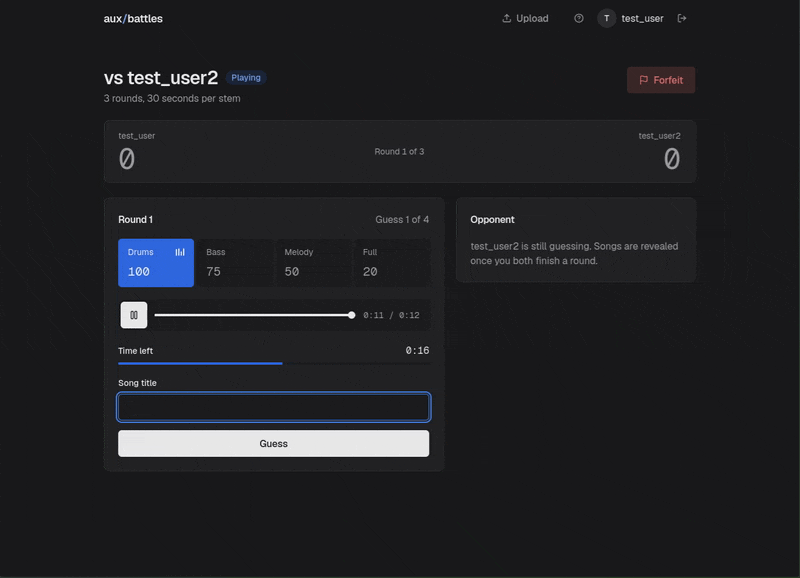
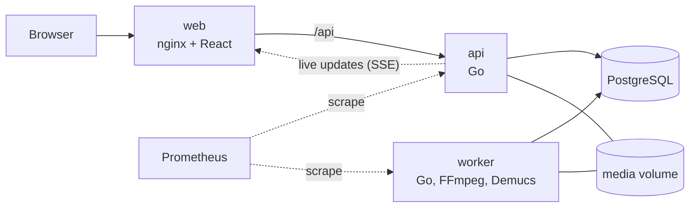

# aux-battles

[](https://github.com/kericchhh/aux-battles/actions/workflows/ci.yml)

A two-player song guessing game. You hear your opponent's song one stem at a
time, drums first, then bass, melody and the full mix, and earlier correct
guesses score more. A Go API and worker, a React client and PostgreSQL, run on
Docker Compose or on Kubernetes with GitOps.



[Full 40-second walkthrough](https://github.com/user-attachments/assets/b1b42644-cd32-45ce-9514-35b44c18191c)

## Highlights

- **Kubernetes:** a Helm chart with migrations as a pre-install and pre-upgrade
  hook, PostgreSQL run by the CloudNativePG operator, and a local k3d cluster.
- **GitOps:** Argo CD deploys everything from `main` through an app of apps,
  with automatic sync, pruning and self-heal.
- **Monitoring and alerting:** kube-prometheus-stack finds the app through
  ServiceMonitors; community and app-specific alert rules reach Telegram
  through Alertmanager.
- **CI:** Go and TypeScript checks, tests against PostgreSQL, Trivy image
  scans, Helm lint, kubeconform and a smoke install on a throwaway k3d cluster
  for every pull request; pushes to `main` and version tags publish images to
  GHCR, and tags create releases.
- **Single-host deploys:** a systemd timer pulls new releases into a Compose
  stack, with a backup before each deploy and rollback on failed health
  checks.

## Architecture



An admin uploads an MP3, which the API stores and queues in PostgreSQL. The
worker claims jobs with `FOR UPDATE SKIP LOCKED`, cuts a clip with FFmpeg and
separates it into stems with Demucs. During a battle, PostgreSQL `NOTIFY`
events reach the API, which pushes updates to both players over server-sent
events.

## Quick start

```sh
cp .env.example .env
docker compose up --build -d
```

Open the game at <http://localhost:8000>. The first song takes longer while
Demucs downloads its model. To run a published release instead of building:

```sh
AUX_VERSION=0.3.0 docker compose pull migrate api web worker
AUX_VERSION=0.3.0 docker compose up -d --no-build
```

To run it on Kubernetes, see the [Kubernetes guide](docs/kubernetes.md).

## Documentation

| Guide | Covers |
| --- | --- |
| [Kubernetes](docs/kubernetes.md) | Cluster setup, Argo CD, monitoring, alerts and maintenance |
| [Development](docs/development.md) | Running the API, worker and client on your host, and tests |
| [API](docs/api.md) | Routes, game rules and examples |
| [Song processing](docs/worker.md) | Jobs, retries and media handling |
| [Migrations](docs/migrations.md) | Notes for applying and rolling back schema changes |
| [Observability](docs/observability.md) | Prometheus, Grafana, Loki and Telegram alerts on Compose |
| [Runbooks](docs/runbooks) | Deploys, backups and what to do when an alert fires |

## License

[MIT](LICENSE). Music in the demo is credited in [CREDITS.md](CREDITS.md).
